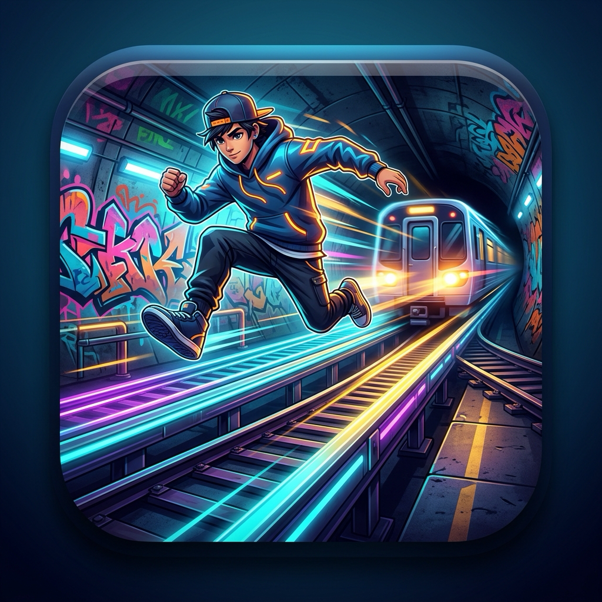

# 🚇 Subway Rush (iOS)

An arcade 3-lane subway runner game built natively for **iOS 17+** using **Swift 6** and **SwiftUI**.



---

## ⚡ Features

- **Perspective 3-Lane Track Engine**:
  - Real-time 60 / 120 FPS hardware-accelerated rendering powered by SwiftUI `TimelineView` and `Canvas`.
  - Non-linear 3D foreshortening perspective with dynamic track sleepers, tunnel rib arches, neon light strips, and electrified third rails.
- **Dynamic Obstacles & Hazards**:
  - **Subway Trains**: High-speed oncoming metro carriages with glowing halogen headlights and illuminated beam cones.
  - **Low Roadwork Barriers**: Striped hazard hurdles requiring a jump.
  - **High Clearance Pipes**: Overhead warning beams requiring a slide/crouch roll.
  - **Concrete Buffers & Safety Cones**: Track barricades requiring lane switches.
- **Power-Ups System**:
  - 🧲 **Coin Magnet**: Draws all gold coins across tracks to your runner.
  - ⚡ **2X Multiplier**: Supercharges score accumulation rate.
  - 👟 **Super Sneakers**: High-jump bounce ability to leap clean over obstacles.
  - 🛡️ **Energy Shield**: Absorbs a collision without ending your run.
  - 🚀 **Turbo Jetpack**: Launches the runner onto the overhead high-line skyway filled with coins!
- **Runner Locker (Characters)**:
  - **Jack** *(Street Cruiser)*: Balanced lane agility and high jump.
  - **Tricky** *(Track Acrobat)*: +35% wider coin collection radius.
  - **Fresh** *(Metro Beatmaker)*: +50% score boost on all multipliers.
  - **Spike** *(Punk Rebel)*: Starts every subway run with a free energy shield.
  - **Yutani** *(Cyber Tech Prodigy)*: +25% jump lift & extended skyway turbo duration.
- **Upgrades Shop**:
  - Spend collected coins to upgrade durations of Coin Magnet, 2X Multiplier, Super Sneakers, and Turbo Jetpack up to Level 5.
- **Missions & Quests**:
  - Daily & milestone goals (e.g. dodging trains, coin streaks, target scores) with coin rewards.
- **Pure Native Audio & Haptics**:
  - Procedural sound synthesis via `AVAudioEngine` (custom waveform chimes, whooshes, impacts, and shield breaks — zero missing asset dependencies).
  - Tactile iOS haptics using `UIImpactFeedbackGenerator` and `UINotificationFeedbackGenerator`.
- **Flexible Controls**:
  - Responsive swipe gestures (Swipe Left/Right, Swipe Up to Jump, Swipe Down to Slide).
  - Optional on-screen touch arrow buttons.
  - Full keyboard arrow key support for Mac, iPad, and iOS Simulator testing.

---

## 📂 Project Architecture

```
Subway/
├── project.yml                          # Declarative XcodeGen project specification
├── Subway.xcodeproj                     # Native Xcode project
└── Subway/
    ├── App/
    │   ├── SubwayApp.swift              # iOS App entry point (@main)
    │   └── ContentView.swift            # Root coordinator and screen transition manager
    ├── Game/
    │   ├── GameState.swift              # Main game engine, physics, state, and persistence
    │   ├── GameScene.swift              # 60fps rendering canvas with gesture & key handlers
    │   ├── GameRenderer.swift           # 3D perspective projection math, tunnel, trains, & runner drawing
    │   ├── Obstacle.swift               # Track obstacles, coins, and power-up models
    │   └── SoundManager.swift           # Native procedural audio synthesis and iOS haptics
    ├── Models/
    │   ├── CharacterModel.swift         # Character roster, perk abilities, and styling
    │   ├── Mission.swift                # Achievement quests and reward logic
    │   └── PowerUpType.swift            # Power-up definitions and upgrade tiers
    ├── Views/
    │   ├── HUDView.swift                # In-game glassmorphic HUD, live meters, and pause overlay
    │   ├── MainMenuView.swift           # Title screen, runner card, play button, and navigation
    │   ├── GameOverView.swift           # Run summary, high score fanfare, and restart buttons
    │   ├── ShopView.swift               # Upgrades store with level pips
    │   ├── CharacterSelectionView.swift # Runner locker and unlock system
    │   ├── MissionsView.swift           # Mission progress cards and reward claim
    │   └── SettingsView.swift           # Audio, haptics, control preferences, and game guide
    └── Resources/
        ├── Info.plist                   # iOS application metadata and portrait lock
        └── Assets.xcassets/             # 1024x1024 universal app icon
```

---

## 🚀 How to Run

### Option 1: In Xcode
1. Double-click `Subway.xcodeproj` to open it in Xcode.
2. Select any iOS Simulator (e.g. **iPhone 17**, **iPhone 18 Pro**, or connected iOS device).
3. Press **Cmd + R** (Run) to build and launch!

### Option 2: Command Line
```bash
# Build for iOS Simulator
xcodebuild -project Subway.xcodeproj -scheme Subway -destination 'platform=iOS Simulator,name=iPhone 17' build
```

To regenerate the project anytime after adding new files:
```bash
xcodegen generate
```